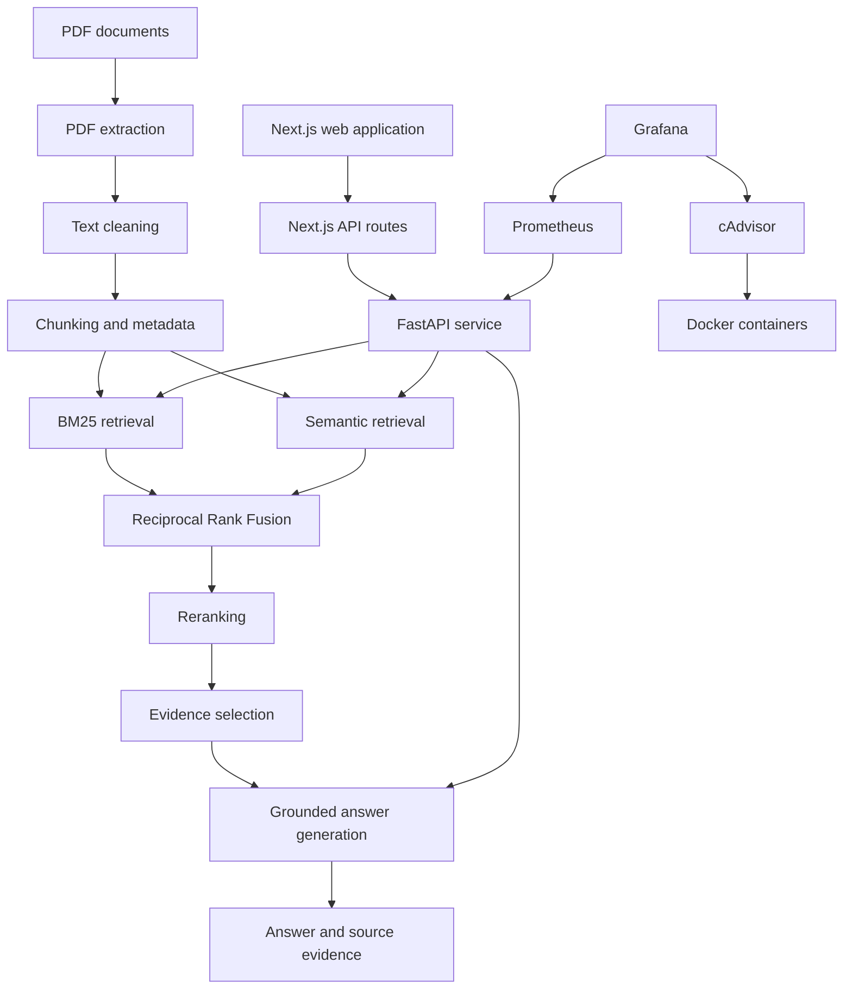

# Enterprise AI Knowledge Platform

[](https://github.com/srinathreddy-dev/enterprise-ai-knowledge-platform/actions/workflows/ci.yml)
[](https://github.com/srinathreddy-dev/enterprise-ai-knowledge-platform/actions/workflows/docker-build.yml)

A portfolio-scale enterprise Retrieval-Augmented Generation (RAG) platform that ingests PDF documents, retrieves relevant evidence through hybrid search, reranks candidate passages, and generates grounded answers with document and page references.

The application combines a **FastAPI** backend, a **Next.js** frontend, **BM25 + semantic retrieval**, reciprocal-rank fusion, reranking, OpenAI-powered generation, and an observability stack built with **Prometheus, Grafana, and cAdvisor**.

> This is an engineering portfolio project designed to demonstrate an end-to-end document question-answering system. It is not presented as a fully managed multi-tenant production SaaS.

## Contents

- [Highlights](#highlights)
- [Architecture](#architecture)
- [Technology stack](#technology-stack)
- [Repository layout](#repository-layout)
- [Requirements](#requirements)
- [Run with Docker Compose](#run-with-docker-compose)
- [Run locally for development](#run-locally-for-development)
- [Using the application](#using-the-application)
- [API reference](#api-reference)
- [Evaluation and testing](#evaluation-and-testing)
- [Observability](#observability)
- [Configuration](#configuration)
- [Security and operational notes](#security-and-operational-notes)
- [Known limitations](#known-limitations)
- [Roadmap](#roadmap)

## Highlights

- PDF text extraction, cleanup, and word-aware chunking.
- Parallel keyword and semantic retrieval.
- BM25 retrieval combined with semantic retrieval.
- Reciprocal Rank Fusion (RRF) to combine ranked results.
- Candidate reranking to prioritize evidence relevant to the query.
- Grounded answer generation using retrieved document passages.
- Document and page metadata returned with answers.
- Abstention behavior when the available evidence does not adequately support an answer.
- Prompt instructions that treat retrieved document text as untrusted input.
- PDF upload and indexed-document listing through the web application.
- API-key authentication for protected API endpoints.
- Request validation, rate limiting, and upstream LLM error handling.
- Prometheus application metrics and Grafana dashboards.
- cAdvisor container resource metrics.
- Docker Compose deployment and GitHub Actions automation.

## Architecture

The core request path is:

1. PDF documents are read and text is extracted page by page.
2. Text is normalized and split into overlapping chunks with source metadata.
3. BM25 and semantic retrieval independently find candidate passages.
4. Reciprocal Rank Fusion combines the ranked candidate lists.
5. The reranking stage reorders candidates by query relevance.
6. Selected evidence is passed to the answer-generation component.
7. The API returns the answer along with supporting evidence and source metadata.



## Technology stack

| Area | Technologies |
|---|---|
| Backend language | Python 3.13 |
| Backend API | FastAPI, Uvicorn |
| Frontend | Next.js 16, React, TypeScript |
| Document processing | PyMuPDF |
| Keyword retrieval | BM25 (`rank-bm25`) |
| Semantic retrieval | Embedding-based retrieval |
| Retrieval fusion | Reciprocal Rank Fusion |
| Reranking | Candidate reranking stage |
| Generation | OpenAI API |
| Metrics | Prometheus client |
| Monitoring | Prometheus, Grafana, cAdvisor |
| Containers | Docker, Docker Compose |
| Backend tests | Pytest |
| CI | GitHub Actions |

## Repository layout

```text
enterprise-ai-knowledge-platform/
├── app/
│   ├── core/             # Settings, logging, and metrics
│   ├── evaluation/       # Retrieval and answer-quality evaluation
│   ├── generation/       # Prompting, LLM client, and RAG services
│   ├── ingestion/        # PDF ingestion, cleaning, and chunking
│   ├── reranking/        # Candidate reranking
│   ├── retrieval/        # BM25, semantic, hybrid, and RRF retrieval
│   └── main.py           # FastAPI application and endpoints
├── data/
│   ├── sample/           # Sample documents, if provided
│   └── uploads/          # Runtime uploads (ignored by Git)
├── frontend/
│   ├── app/
│   │   ├── api/          # Next.js backend proxy routes
│   │   ├── components/   # Chat and document-management UI
│   │   └── page.tsx      # Main dashboard
│   ├── Dockerfile
│   └── package.json
├── monitoring/
│   └── prometheus.yml
├── scripts/              # Evaluation and diagnostic utilities
├── tests/                # Automated Python tests
├── .github/workflows/    # CI and Docker build workflows
├── compose.yaml
├── Dockerfile
├── pyproject.toml
└── README.md
```

## Requirements

For the containerized setup:

- Docker Desktop with Docker Compose.
- An OpenAI API key.
- An application API key of your choice.

For local development:

- Python 3.13.
- Node.js 24 and npm.
- An OpenAI API key.
- An application API key of your choice.

## Run with Docker Compose

Docker Compose is the simplest way to start the full application and monitoring stack.

### 1. Clone the repository

```bash
git clone https://github.com/srinathreddy-dev/enterprise-ai-knowledge-platform.git
cd enterprise-ai-knowledge-platform
```

### 2. Configure environment variables

Create a root `.env` file:

```bash
cat > .env <<'ENVVARS'
OPENAI_API_KEY=replace-with-your-openai-api-key
APP_API_KEY=replace-with-a-long-random-application-key
ENVVARS
```

Replace both placeholder values with your own secrets. Do not commit this file.

### 3. Build and start the services

```bash
docker compose up -d --build
```

### 4. Check service status

```bash
docker compose ps
```

The API has a health check, and the frontend waits for the API service to become healthy before starting.

### 5. Open the services

| Service | Local URL |
|---|---|
| Next.js application | http://localhost:3000 |
| FastAPI health | http://localhost:8000/health |
| FastAPI readiness | http://localhost:8000/ready |
| FastAPI interactive docs | http://localhost:8000/docs |
| Prometheus | http://localhost:9090 |
| Grafana | http://localhost:3001 |
| cAdvisor | http://localhost:8080 |

### 6. View logs and stop services

```bash
# Follow API logs
docker compose logs -f api

# Follow frontend logs
docker compose logs -f frontend

# Stop containers (keep named volumes)
docker compose down

# Stop containers and remove named volumes
# Warning: this deletes persisted monitoring/model-cache data.
docker compose down -v
```

## Run locally for development

The following starts the backend and frontend as separate development processes. The root `.env` file is used by Docker Compose; for local backend development, export the required variables in your shell.

### 1. Backend

Create and activate a virtual environment, then install the project and test dependencies:

```bash
python3.13 -m venv .venv
source .venv/bin/activate
python -m pip install --upgrade pip
pip install . pytest httpx
```

Set the environment variables in the same terminal:

```bash
export OPENAI_API_KEY="your-openai-api-key"
export APP_API_KEY="your-long-random-application-key"
```

Start the API:

```bash
uvicorn app.main:app --reload
```

The backend runs at http://localhost:8000.

### 2. Frontend

In a second terminal:

```bash
cd frontend
npm ci
```

Configure the frontend server environment. The Next.js API routes proxy requests to FastAPI and attach the server-side application key:

```bash
export API_BASE_URL="http://localhost:8000"
export APP_API_KEY="your-long-random-application-key"
npm run dev
```

The frontend runs at http://localhost:3000.

Keep the `APP_API_KEY` server-side. Do not expose it through a `NEXT_PUBLIC_` variable or commit it to source control.

## Using the application

1. Open http://localhost:3000.
2. Use the document-management section to select and upload a PDF.
3. The frontend sends the upload through its Next.js API route to the FastAPI document endpoint.
4. After the document is indexed, ask a question in the AI assistant.
5. Review the generated response and the supporting document evidence.

The upload interface accepts PDF files up to 10 MB. The backend validates uploaded files and indexes them into the knowledge service.

Example questions depend on the documents you have loaded. For example:

- "What is the annual vacation allowance for full-time employees?"
- "What does the document say about password requirements?"

The system should rely on retrieved evidence and indicate when the available information is insufficient to answer.

## API reference

Interactive API documentation is available at http://localhost:8000/docs when the backend is running.

| Method | Endpoint | Purpose | Authentication |
|---|---|---|---|
| GET | `/health` | Liveness/health check | No API key |
| GET | `/ready` | Service readiness | No API key |
| GET | `/metrics` | Prometheus metrics | Internal monitoring endpoint |
| GET | `/documents` | List sample and uploaded documents | `X-API-Key` |
| POST | `/documents/upload` | Upload and index a PDF | `X-API-Key` |
| POST | `/ask` | Ask a question using retrieved evidence | `X-API-Key` |

### Example: ask a question

```bash
curl -X POST "http://localhost:8000/ask" \\
  -H "Content-Type: application/json" \\
  -H "X-API-Key: $APP_API_KEY" \\
  -d '{"question":"What is the annual vacation allowance?"}'
```

### Example: list indexed documents

```bash
curl "http://localhost:8000/documents" \\
  -H "X-API-Key: $APP_API_KEY"
```

### Example: upload a PDF

```bash
curl -X POST "http://localhost:8000/documents/upload" \\
  -H "X-API-Key: $APP_API_KEY" \\
  -F "file=@./path/to/document.pdf"
```

The question response includes the generated answer and retrieved evidence, with source metadata such as document name, page number, chunk identifier, and relevance information.

## Evaluation and testing

Run the complete backend test suite:

```bash
pytest -v
```

The latest verified local test run completed with:

- **178 passed**
- **0 failed**
- **6 warnings**
- **4.69 seconds**

The warnings were dependency deprecation warnings associated with PyMuPDF/SWIG and Starlette/AnyIO; they did not cause test failures.

The repository also includes retrieval and answer-quality evaluation utilities under `app/evaluation/` and runnable scripts under `scripts/`. The evaluation dataset is deliberately small and manually labelled. Its results are useful for regression checks and project diagnostics, not as a claim of broad real-world benchmark performance.

## CI and Docker build automation

Two GitHub Actions workflows run on pushes and pull requests targeting `main`:

- **Enterprise AI Platform CI** — installs Python dependencies and runs `pytest -v`; separately installs frontend dependencies, runs ESLint, and builds the Next.js application.
- **Docker Image Build** — builds the backend Docker image using Docker Buildx. The workflow validates the image build and does not push the image to a registry.

The workflow status badges at the top of this README link to their run histories.

## Observability

The Docker Compose stack includes Prometheus, Grafana, and cAdvisor.

The Prometheus configuration scrapes the FastAPI `/metrics` endpoint and cAdvisor metrics. Grafana dashboards provide API request and response indicators and container resource signals.

Prometheus targets configured in `monitoring/prometheus.yml`:

- `api:8000` — application metrics.
- `cadvisor:8080` — container metrics.

Grafana is exposed on host port **3001** by the supplied Compose file (container port 3000).

Configured alert rules include Docker CPU usage, Docker memory usage, and API availability. Email notifications require a configured Grafana contact point and SMTP settings; notification delivery is not enabled automatically by the Compose file.

## Configuration

The main environment variables used by the application are:

| Variable | Purpose | Required |
|---|---|---|
| `OPENAI_API_KEY` | Authenticates requests to the OpenAI API | Yes for LLM-backed operation |
| `APP_API_KEY` | Protects question and document API endpoints | Yes |
| `OPENAI_MODEL` | Model used for answer generation (default: `gpt-4.1-mini`) | No |
| `OPENAI_TIMEOUT_SECONDS` | OpenAI request timeout (default: `60`) | No |
| `OPENAI_MAX_RETRIES` | OpenAI client retry count (default: `2`) | No |
| `APP_NAME` | Application name | No |
| `ENVIRONMENT` | Runtime environment label | No |

Never commit API keys, credentials, or local `.env` files.

## Security and operational notes

- Protected API calls require the `X-API-Key` header.
- The Next.js API routes keep the backend application key on the server side and proxy browser requests to FastAPI.
- Uploaded files are checked for PDF extension, size, and validity by the application.
- The upload UI enforces a 10 MB maximum file size; the backend performs its own validation as well.
- Retrieved document text is treated as untrusted evidence in the answer-generation prompt.
- API rate limiting and error handling are implemented in the backend.
- The Compose file uses named volumes for the Hugging Face cache, Prometheus data, and Grafana data.
- The cAdvisor service is configured with privileged access and host filesystem mounts for container monitoring. Review these permissions before adapting the Compose stack to a shared or internet-facing host.
- This portfolio setup does not claim enterprise-grade identity management, tenant isolation, or production hardening.

## Known limitations

- The evaluation corpus and query set are small and manually curated.
- Evaluation scores should be interpreted as development diagnostics, not universal measures of RAG quality.
- Retrieval may return partially relevant passages even when the answer-generation layer correctly abstains.
- The Docker workflow builds an image but does not publish it to a container registry.
- Grafana alert notification delivery requires additional contact-point and SMTP configuration.
- The Compose stack is intended for local demonstration and development, not as a complete production deployment blueprint.

## Roadmap

Potential future extensions include:

- Broader evaluation datasets and repeatable quality/performance baselines.
- Document versioning, deletion, and access-control policies.
- User authentication and role-based authorization.
- Tenant isolation for multi-user deployments.
- Distributed tracing and expanded observability.
- Cloud deployment and orchestration.
- Image publishing and deployment automation.

## License

This repository is a portfolio and learning project. Unless a separate license file is added, all rights are reserved by the repository owner.

## CI verification snapshot

At the time of this documentation update, the `main` branch had successful GitHub Actions runs for both the Python/frontend CI workflow and the Docker image build workflow. The CI workflow contains separate Python test and Next.js frontend build jobs. The Docker workflow builds the backend image without publishing it to a registry.